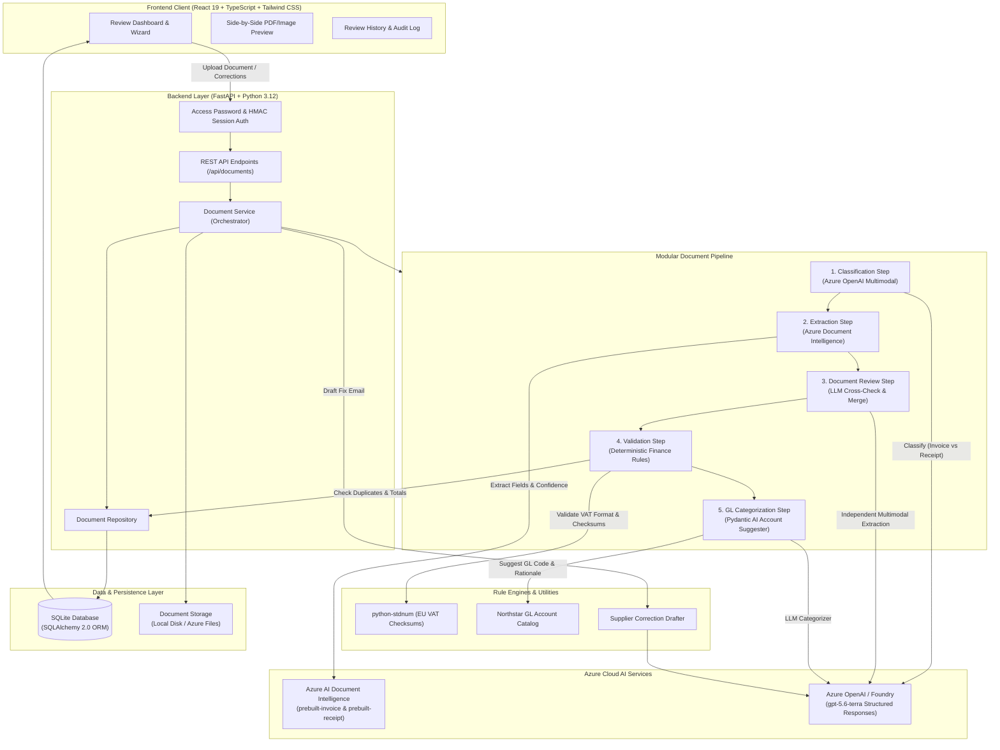

# MASTER PROJECT AUDIT REPORT

## Project: Invoice Review — End-to-End Multilingual Invoice & Receipt Processing Platform
**Target Professional:** Mahdi Akrami — AI Engineer & Practitioner  
**Repository:** `e2e-invoice-review`  
**Audit Date:** September 2026  
**Status:** Complete Implementation (Multi-Branch: `main` starter, `development`, and `solution` reference)

---

## 1. Project Overview

* **Project Name:** Invoice Review (Enterprise Financial Document Review System)
* **Suggested Professional Title:** Hybrid AI Financial Document Processing & Human-in-the-Loop Review Platform
* **Project Category:** Applied AI / Intelligent Document Processing (IDP) / Enterprise FinTech Automation / Human-in-the-Loop (HITL) Systems
* **One-Line Description:** An enterprise-grade, human-in-the-loop financial review platform combining Azure AI Document Intelligence, Azure OpenAI structured LLM cross-checking, and deterministic European finance rules to process multilingual invoices and receipts.
* **Short Professional Description:** A full-stack intelligent document processing application built for European accounts payable operations (modeled around Northstar Facilities B.V., Amsterdam). The system automates document classification, OCR extraction, offline EU VAT verification, arithmetic total reconciliation, and General Ledger (GL) account categorization across multilingual documents (English, Dutch, German, French). Utilizing a hybrid architecture, it pairs high-precision Document Intelligence OCR with multimodal Azure OpenAI models to cross-check data, backfill omissions, and draft context-aware supplier correction emails, all governed by pure deterministic business rules and an interactive human review interface.
* **Main Problem:** Accounts payable teams handle large volumes of unstructured, multilingual invoices and receipts across digital PDFs, mobile phone photos, and degraded scans. Manual review is slow, prone to arithmetic/checksum errors, and vulnerable to VAT non-compliance and duplicate billing. Pure LLM approaches suffer from hallucinations and unpredictability in financial audits, while conventional OCR cannot resolve semantic ambiguities or map chart-of-accounts entries.
* **Main Solution:** A multi-stage hybrid processing pipeline:
  1. Multimodal document classification distinguishing invoices from receipts.
  2. Primary structured extraction via Azure AI Document Intelligence (`prebuilt-invoice` and `prebuilt-receipt`).
  3. Independent multimodal LLM cross-check via Azure OpenAI Responses API, filling missing fields while maintaining strict provenance (`document_intelligence`, `llm_fallback`, `human`).
  4. Pure deterministic validation engine enforcing European VAT format/checksum rules (`python-stdnum`), customer identity matching, arithmetic reconciliation (subtotal + tax = total within €0.01), and duplicate detection.
  5. Automated General Ledger (GL) coding suggestions backed by reasoning and confidence scores.
  6. Human-in-the-loop React dashboard enabling field-level corrections, live re-validation, manual GL overrides, approval/rejection state changes, and automated supplier correction email generation.
* **Target Users / Organization:** Finance administrators, accounts payable specialists, controllers, and bookkeeping teams in European enterprises.
* **Current Project Status:** Fully implemented production architecture with multi-stage Docker builds, Azure Container Apps deployment specifications, automated evaluation benchmarks, and complete frontend/backend source code.

---

## 2. Architecture

### System Architecture Overview

The system is designed with a strict separation of concerns, ensuring that AI models provide extraction evidence while business logic and financial policies remain 100% deterministic:

1. **Frontend Presentation Layer:** React 19 single-page application (SPA) with TypeScript strict mode and Tailwind CSS 4. Offers a 3-step review wizard (Welcome → Upload/Preview → Review & Decision), visual side-by-side document preview, field provenance badges, and historical record management.
2. **Backend API & Service Layer:** FastAPI running on Python 3.12+ structured around clean layered principles:
   - `routes.py`: HTTP endpoints, file streaming, request/response validation.
   - `service.py`: Business orchestration coordinating storage, pipeline execution, revalidation, and decision workflows.
   - `pipeline/`: Composable pipeline engine implementing a `PipelineStep` Protocol (`ClassificationStep`, `ExtractionStep`, `DocumentReviewStep`, `ValidationStep`, `GlCategorizationStep`).
   - `repository.py`: Data persistence isolating SQLAlchemy ORM operations.
   - `providers/`: Strict boundary adapters wrapping Azure Document Intelligence and Azure OpenAI SDKs to prevent vendor types from leaking into core domain logic.
3. **Hybrid AI & Data Extraction Layer:**
   - **Classification:** Azure OpenAI multimodal agent classifies documents into `invoice` or `receipt`.
   - **Primary Extraction:** Azure AI Document Intelligence extracts structured entities (vendor, customer, dates, tax, totals, line items).
   - **Secondary Extraction & Cross-Check:** Azure OpenAI independently processes raw document bytes, identifies discrepancies, and backfills missing values.
4. **Deterministic Validation & Accounting Engine:**
   - Pure Python validation rules checking EU VAT checksums, company identity, date validity, arithmetic tolerances, and duplicate keys.
   - Northstar Facilities B.V. GL Account catalog mapping with automated LLM suggestions.
5. **Data & Storage Layer:**
   - SQLite relational database via SQLAlchemy 2.0 ORM storing complete audit trails and JSON state payloads.
   - Local disk or mounted Azure Files persistent storage for source document files.
6. **Infrastructure & Deployment:**
   - Multi-stage Docker containerization serving static SPA assets and API from a unified origin.
   - Azure Container Apps (ACA) with external HTTPS ingress, Azure Files volume binding, and secret-managed environment configurations.

### Architecture Diagram



---

## 3. Technology Stack

### Languages
* **Python 3.12+**: Modern typed backend, async HTTP handlers, protocol-based pipeline abstractions.
* **TypeScript 6.0 (Strict Mode)**: Comprehensive type contracts for frontend state, document models, and API responses.
* **SQL**: Relational queries and composite indexing for duplicate detection.
* **HTML5 / CSS3**: Modern semantic web and responsive styling.

### AI / Machine Learning
* **Azure AI Document Intelligence (v1.0.2)**: Cloud OCR, layout analysis, table extraction, and specialized key-value models (`prebuilt-invoice`, `prebuilt-receipt`).
* **Multimodal Document Processing**: Direct binary ingestion and evaluation of PDFs, PNGs, and JPEGs.
* **OCR Confidence Scoring**: Evaluation and thresholding of field-level OCR extraction confidence.

### LLM / Generative AI
* **Azure OpenAI Service / Azure AI Foundry**: Enterprise model serving (`gpt-5.6-terra` Global Standard deployment).
* **OpenAI Responses API (`openai>=2.45.0`)**: Direct schema generation and multimodal token evaluation.
* **Pydantic AI (`pydantic_ai`)**: Type-safe agent framework utilizing `Agent`, `BinaryContent`, and `OpenAIResponsesModel`.
* **Strict Structured Outputs**: JSON Schema validation (`strict: True`) ensuring 100% adherence to Pydantic models.
* **Multimodal Prompt Engineering**: Dynamic system instructions, structured payload serializations, and binary file attachments.
* **Automated Email Drafting**: Zero-shot context-conditioned generation of supplier correction requests.

### Backend
* **FastAPI (0.139.0)**: High-performance async ASGI web framework.
* **Pydantic v2 (2.13.4)**: Ultra-fast data validation, serialization, and schema definition.
* **Pydantic Settings (2.14.2)**: Environment-based configuration management.
* **SQLAlchemy 2.0 (2.0.51)**: Type-safe database ORM and query builder.
* **Uvicorn (0.51.0)**: Production ASGI server.
* **python-multipart (0.0.32)**: Streaming multipart form-data parser for file uploads.
* **python-stdnum (2.2)**: European VAT validation library (syntax, country prefixes, and mathematical checksums).
* **Starlette Middleware**: Custom authentication and CORS management.

### Frontend
* **React 19 (19.2.7)**: Modern declarative UI framework utilizing latest hook paradigms (`useCallback`, `useState`, `useEffect`).
* **Vite 8 (8.1.4)**: Next-generation fast frontend build tool and development server.
* **Tailwind CSS 4 (4.3.2)**: Utility-first design system with `@tailwindcss/vite` integration.
* **TypeScript-ESLint & ESLint 10**: Modern linting and static code analysis.

### Databases & Storage
* **SQLite**: Fast, embedded relational database.
* **SQLAlchemy ORM**: Entity mapping, metadata creation, and typed repository queries.
* **Azure Files / Local Volume Storage**: Persistent binary storage for uploaded invoices and receipts.

### Infrastructure & DevOps
* **Docker**: Multi-stage container build packaging the React Vite SPA and FastAPI backend into a unified image.
* **Azure Container Apps (ACA)**: Serverless container deployment with managed HTTPS, scaling, and secrets integration.
* **Azure Container Registry (ACR)**: Private container image hosting.
* **uv**: Blazing fast Python package manager with locked reproducible bounds (`--locked`).
* **pnpm (v11)**: Fast, disk-space efficient Node.js package manager with frozen lockfiles (`--frozen-lockfile`).

### Developer Tools & Evaluation
* **Ruff (0.15.21)**: High-speed Python linter and formatter.
* **ReportLab (4.5.1) & Pillow (11.3.0)**: Synthetic document generator used to construct the 13-document multilingual evaluation corpus.
* **IPython / ipykernel**: Interactive experimentation and prototype execution.
* **Bash Orchestration (`scripts/dev.sh`)**: Unified script for dependency validation, environment checks, and multi-process startup.

---

## 4. Key Features

### AI & Intelligent Processing Features
* **Automatic Document Kind Classification:** Distinguishes between invoices (bills requesting payment) and receipts (records of paid expenses) using multimodal LLM vision.
* **Hybrid Extraction Architecture:** Pairs specialized Azure Document Intelligence models with Azure OpenAI to eliminate OCR blind spots while retaining deterministic traceability.
* **Independent LLM Cross-Check:** Performs a zero-leakage second read of raw file bytes and computes field-by-field agreement, discrepancies, and fallbacks.
* **Explicit Field Provenance:** Tracks and displays the exact origin of every data point (`document_intelligence`, `llm_fallback`, or `human`).
* **Automated General Ledger (GL) Categorization:** Evaluates vendor name, item descriptions, and totals against Northstar's chart of accounts (`6100`–`6190`), providing suggested codes, confidence percentages, and audit rationales.
* **One-Click Supplier Correction Email Drafter:** Translates deterministic validation errors (e.g., missing VAT, calculation mismatch) into polite, professional email drafts ready for copy-pasting.

### Backend & Business Logic Features
* **Modular Pipeline Architecture:** Implements a pipeline pattern decoupling individual processing stages into testable, composable steps.
* **Offline European VAT Validation:** Validates format and checksums across all EU member states locally without external network dependencies.
* **Strict Arithmetic Reconciliation:** Verifies that `subtotal + total_tax == invoice_total` within a strict €0.01 tolerance threshold.
* **Duplicate Invoice Prevention:** Employs composite normalized indexing (`vendor_name` + `invoice_number`) to detect duplicate submissions across active reviews.
* **State Machine Lifecycle Management:** Enforces document status progression (`processing` → `ready` / `needs_review` → `approved` / `rejected` / `failed`), preventing edits once decided.
* **Cookie-Based HMAC Session Security:** Lightweight, constant-time password authentication (`hmac.compare_digest`) with secure, HTTP-only cookie issuance.

### User Experience & Frontend Features
* **Guided 3-Step Wizard:** Intuitive step-by-step review interface (Welcome Portal → Upload & Processing Progress → Detailed Review).
* **Interactive Document Preview:** Side-by-side split screen showing uploaded PDFs or images alongside extracted data fields.
* **Visual Discrepancy & Fallback Table:** Clean comparison table highlighting where Document Intelligence and Azure OpenAI agreed or diverged.
* **In-Place Field Editing & Instant Re-Checking:** Allows administrators to modify any extracted scalar value, which tags the field as `human` and reruns all validation rules immediately.
* **Manual GL Override:** Gives finance administrators final authority to override AI-suggested accounting codes before approval.
* **Complete Review History:** Sortable list of historical documents with visual status badges (`Ready`, `Needs Review`, `Approved`, `Rejected`, `Failed`) and safe local deletion.

---

## 5. AI / LLM Capabilities & Implementation Details

| Capability | Implementation in Project | Technical Detail |
|---|---|---|
| **Foundation Models** | Azure OpenAI `gpt-5.6-terra` / GPT-4o multimodal | Deployed in Azure Sweden Central under Global Standard tier |
| **Document OCR Models** | Azure AI Document Intelligence | `prebuilt-invoice` and `prebuilt-receipt` models in West Europe |
| **Agent Framework** | Pydantic AI (`pydantic_ai.Agent`) | Structured agents with typed input/output and explicit system instructions |
| **Structured Outputs** | OpenAI Responses API JSON Schema | `strict: True` schema enforcement ensuring guaranteed Pydantic deserialization |
| **Multimodal Vision** | Base64-encoded PDF and image payloads | Binary ingestion directly into prompt context using `input_file` and `input_image` |
| **Prompt Engineering** | Role-based domain prompts | Financial policy and persona constraints ("Maya, Finance Administration") |
| **Ensemble & Reconciliation** | Deterministic Field Merger | Primary OCR precedence; LLM fills empty fields; discrepancy tracking |
| **Cost & Token Modeling** | Granular Token Envelopes | Documented pricing formulas: ~$0.034 per hybrid document; ~$0.0125 per correction email |
| **Model Evaluation** | Evaluation Harnesses | `evaluate_corpus.py` and `evaluate_hybrid.py` testing against golden corpus manifest |

---

## 6. Database & Data Architecture

### Relational Schema (`documents` Table)

The database utilizes SQLite managed via SQLAlchemy 2.0 with the following architecture:

* **Primary Key:** `id` (String UUID v4, 36 chars)
* **File Metadata:** `original_filename`, `stored_filename` (unique), `content_type`
* **Status Enum:** `status` (indexed: `processing`, `ready`, `needs_review`, `approved`, `rejected`, `failed`)
* **Normalized Search Keys:**
  - `normalized_vendor_name` (lowercased, whitespace-collapsed)
  - `normalized_invoice_number` (lowercased, whitespace-collapsed)
  - **Index:** Composite index `ix_documents_duplicate_key` on `(normalized_vendor_name, normalized_invoice_number)` for instant O(1) duplicate checks.
* **JSON Payloads:**
  - `classification`: Model classification result, confidence, and reasoning.
  - `extraction`: Raw mapped fields from Document Intelligence.
  - `review_data`: Normalized working model containing active values and field sources (`document_intelligence`, `llm_fallback`, `human`).
  - `document_review`: LLM cross-check comparisons, diffs, and fallback audit records.
  - `accounting_coding`: GL suggestion, confidence, rationale, selected code, and override flag.
  - `validation`: Summary findings and boolean error flags.
  - `issues`: Array of granular `ValidationIssue` objects (`code`, `field`, `severity`, `message`).
* **Audit Columns:** `created_at` (UTC timestamp), `updated_at` (UTC timestamp)

---

## 7. APIs & Integrations

### API Specifications (FastAPI)

* `GET /health`: Liveness probe for orchestration and container monitoring.
* `GET /api/accounting/gl-accounts`: Retrieves the Northstar Facilities chart of accounts catalog.
* `POST /api/documents`: Multipart upload handling PDF/PNG/JPEG files (max 4 MB) and executing the entire 5-step pipeline.
* `GET /api/documents`: Lists all processed documents ordered chronologically (newest first).
* `GET /api/documents/{id}`: Retrieves complete review details, audit comparisons, and issues for a document.
* `GET /api/documents/{id}/file`: Streams the original binary file with proper `Content-Type` for in-browser rendering.
* `PUT /api/documents/{id}`: Submits human corrections for review fields and reruns deterministic validation.
* `PUT /api/documents/{id}/accounting`: Confirms or overrides the selected General Ledger account code.
* `POST /api/documents/{id}/decision`: Sets the terminal review decision (`approved` or `rejected`), locking the document from further edits.
* `POST /api/documents/{id}/correction-email`: Generates an AI-drafted supplier correction email based on fixable validation issues.
* `DELETE /api/documents/{id}`: Deletes the database record and associated physical file.
* `POST /api/auth/login`, `GET /api/auth/session`, `POST /api/auth/logout`: Manages password-based session authentication.

---

## 8. Engineering & Quality Standards

* **Layered Clean Architecture:** Clear boundaries where transport (FastAPI), domain models (Pydantic), persistence (SQLAlchemy), and external adapters (Azure/OpenAI) never leak abstractions.
* **Reproducible Dependency Management:** Strict dependency pinning with `uv` (`add-bounds = "exact"`, `exclude-newer = "7 days"`) and `pnpm` (`savePrefix: ""`, `minimumReleaseAgeStrict: true`).
* **Pure Business Logic:** Validation rules are implemented as side-effect-free, pure Python functions easily verifiable in isolation.
* **Evaluation & Benchmarking Harness:** Custom automated scripts (`scripts/evaluate_corpus.py` and `scripts/evaluate_hybrid.py`) benchmarking extraction accuracy, exact matches, and policy enforcement against a 13-document golden corpus.
* **Cost Engineering:** Thorough operational cost analysis documented in `docs/pricing.md`, covering F0 free tiers, S0 retail costs, and per-token OpenAI planning envelopes.
* **Security & Hardening:**
  - Password hashing and timing-safe digest comparisons via `hmac.compare_digest`.
  - Secure, HTTP-only, SameSite cookies with automatic HTTPS detection.
  - Maximum upload file size enforcement (4 MB) and content type restrictions (`application/pdf`, `image/png`, `image/jpeg`).

---

## 9. Skills Demonstrated by This Project

### Strong Evidence (Technologies Central to the Project)
* **Python 3.12+ (Async, Typing, Protocols)**
* **FastAPI & Starlette Middleware**
* **Pydantic v2 & Pydantic AI**
* **Azure AI Document Intelligence (Form Recognizer)**
* **Azure OpenAI Service & OpenAI Responses API (Multimodal, Strict JSON Schema)**
* **Intelligent Document Processing (IDP) Architecture**
* **Prompt Engineering & LLM Structured Outputs**
* **React 19 & TypeScript (Strict Mode)**
* **Tailwind CSS 4**
* **SQLAlchemy 2.0 & SQLite**
* **Deterministic Rules Engines & EU VAT Validation (`python-stdnum`)**
* **Docker Multi-Stage Builds & Containerization**
* **uv (Python Package Manager) & pnpm**

### Working Knowledge (Technologies Meaningfully Used)
* **Azure Container Apps (ACA) & Azure Container Registry (ACR)**
* **Azure Files & Persistent Volume Mounts**
* **Azure Identity / Entra ID Authentication**
* **Vite Build System & SPA Architecture**
* **ReportLab & Pillow (Synthetic Data & PDF Generation)**
* **Ruff & ESLint Code Quality Tooling**
* **RESTful API Design & OpenAPI / Swagger Specification**
* **HMAC-SHA256 Session Security**

### Familiar / Limited (Supporting Role)
* **Azure Retail Prices API & FinOps Cost Calculation**
* **Bash Scripting (`dev.sh`)**
* **Multi-Language Document Processing (Dutch, German, French)**

---

## 10. CV-Ready Project Entry

### Project Title
**Hybrid AI Financial Document Review & AP Automation Platform**

### Description
Architected and developed an enterprise-grade intelligent document processing (IDP) platform for automated invoice and receipt auditing across European jurisdictions. Engineered a hybrid extraction pipeline combining Azure Document Intelligence OCR with multimodal Azure OpenAI models, governed by deterministic EU VAT validation rules and an interactive human-in-the-loop React dashboard.

### Key Contributions
* **Hybrid Extraction Architecture:** Designed an ensemble extraction pipeline that routes multilingual documents to Azure Document Intelligence and independently cross-checks raw files via Azure OpenAI, backfilling missing data while retaining strict source provenance.
* **Deterministic Financial Compliance:** Implemented offline European VAT format and checksum validation (`python-stdnum`), arithmetic reconciliation (€0.01 tolerance), and duplicate invoice prevention without external network overhead.
* **Agentic Categorization & Drafting:** Built Pydantic AI agents for automated General Ledger (GL) account classification with audit rationales and dynamic supplier correction email generation for non-compliant submissions.
* **Full-Stack Human-in-the-Loop System:** Created a high-performance React 19 / TypeScript SPA featuring side-by-side document previews, real-time discrepancy tables, inline field editing, and stateful approval workflows.
* **Cloud-Native Deployment & FinOps:** Containerized the full-stack application using multi-stage Docker builds and architected Azure Container Apps deployment with Azure Files persistence and comprehensive token-cost evaluation benchmarks.

### Technologies
Python 3.12, FastAPI, Pydantic v2, Pydantic AI, Azure AI Document Intelligence, Azure OpenAI (`gpt-5.6-terra`), React 19, TypeScript, Tailwind CSS, SQLite, SQLAlchemy 2.0, Docker, Azure Container Apps, uv.

---

## 11. Portfolio Content Structure

```markdown
# Portfolio Case Study: Intelligent Invoice & Receipt Review Platform

## 1. Overview
High-performance financial audit platform streamlining accounts payable review for European facilities management.

## 2. Problem Statement
- Manual AP processing across multiple EU languages (EN, NL, DE, FR) is slow and error-prone.
- Pure LLM extraction risks hallucination in high-stakes financial data.
- Standard OCR fails on unusual layouts and lacks accounting domain reasoning.

## 3. The Solution
A hybrid architecture combining high-accuracy OCR extraction with multimodal LLM cross-checking, bounded by deterministic financial business rules and a human review interface.

## 4. Key Architectural Highlights
- Two-pass extraction: OCR baseline + Multimodal LLM validation.
- Zero-leakage provider boundaries isolating Azure SDKs from core business models.
- Real-time field provenance tracking (`document_intelligence` vs `llm_fallback` vs `human`).
- Automated GL account suggestion with confidence scoring and reviewer override.

## 5. Technology Stack
- **Backend:** FastAPI, Python 3.12, Pydantic AI, SQLAlchemy 2.0.
- **Frontend:** React 19, TypeScript, Tailwind CSS 4, Vite.
- **Cloud & AI:** Azure Document Intelligence, Azure OpenAI Service, Azure Container Apps.

## 6. Verification & Evaluation
- 13-document multilingual evaluation corpus (PDFs, scans, receipts).
- Benchmark scripts measuring field accuracy, exact document matches, and policy agreement.
- Granular FinOps cost breakdown (~$0.034 per hybrid document).
```

---

## 12. Visual Assets in Repository

1. **Architecture Diagram:**
   - Location: `docs/architecture.md` (and embedded Mermaid diagram in Section 2).
   - Description: Target architectural flow from Finance Administrator to React UI, FastAPI, Azure Providers, Deterministic Rules, and SQLite.
2. **Sample Degraded French Invoice:**
   - Location: `samples/generated/11-fr-scan-quality.png`
   - Description: Low-quality scanned supplier invoice in French used to test OCR resilience and LLM fallback performance.
3. **Sample Dutch Thermal Fuel Receipt:**
   - Location: `samples/generated/13-nl-fuel-receipt.png`
   - Description: Thermal fuel expense receipt in Dutch used to evaluate receipt models and expense category classification.
4. **Synthetic Golden Evaluation Corpus:**
   - Location: `samples/generated/*.pdf` (11 multilingual invoices across Dutch, German, French, English).
   - Description: Fictional invoices demonstrating varied layouts, multi-page flows, missing VAT numbers, arithmetic mismatches, and duplicate keys.

---

## 13. SKILLS TO ADD TO MASTER CV

```text
Languages:
- Python (3.12+)
- TypeScript (Strict Mode)
- SQL
- Modern HTML5 / CSS3

AI / ML:
- Intelligent Document Processing (IDP)
- Optical Character Recognition (OCR)
- Multimodal Vision-Language Processing
- Azure AI Document Intelligence (Form Recognizer)
- Extraction Confidence Scoring & Evaluation Benchmarking

LLM / Generative AI:
- Azure OpenAI Service / Azure AI Foundry
- Pydantic AI (Type-Safe Agent Framework)
- OpenAI Responses API (Structured Outputs, Strict JSON Schema)
- Multimodal Prompt Engineering (Binary PDF/Image Ingestion)
- Autonomous Agent Design (Classification, Categorization, Email Drafting)
- LLM Cross-Checking & Discrepancy Reconciliation

Backend:
- FastAPI & Starlette Middleware
- Pydantic v2 & Pydantic Settings
- SQLAlchemy 2.0 (ORM & Typed Mappings)
- Asynchronous API Design (ASGI, Uvicorn)
- Layered / Hexagonal Architecture
- Pipeline Pattern & Protocol Abstractions
- HMAC-SHA256 Session Security

Frontend:
- React 19 (Hooks, Concurrent Patterns)
- Vite 8
- Tailwind CSS 4
- Single Page Application (SPA) Architecture
- Human-in-the-Loop (HITL) UI Engineering

Databases:
- SQLite
- Relational Schema Design & Composite Indexing
- JSON Field Persistence & Audit Trails

Frameworks / Libraries:
- python-stdnum (EU VAT Validation)
- ReportLab & Pillow (Synthetic Document Generation)
- Ruff & ESLint

DevOps / Infrastructure:
- Docker (Multi-Stage Builds)
- Azure Container Apps (ACA)
- Azure Container Registry (ACR)
- Azure Files (Volume Mounts)
- uv (Python Dependency Management)
- pnpm (Node Package Management)

Tools:
- Git & Multi-Branch Workflow Management
- OpenAPI / Swagger UI
- Bash Scripting
- VS Code Workspaces

Other:
- FinOps & LLM Cost Optimization
- European VAT Compliance & Accounting Rules
- Multi-Jurisdictional Multilingual Document Processing
```

---

## 14. Executive Summary

* **What the project is:** A complete, enterprise-grade full-stack Intelligent Document Processing (IDP) and human-in-the-loop review application for European financial invoices and receipts.
* **What problem it solves:** Eliminates tedious, error-prone manual AP auditing and overcomes the hallucination risks of pure LLM solutions by combining specialized OCR, multimodal LLM cross-checks, and deterministic European financial compliance rules.
* **Main architecture:** Clean layered architecture featuring a modular 5-step processing pipeline (FastAPI/Python 3.12), an interactive React 19/TypeScript dashboard, SQLite relational persistence with JSON audit logs, and multi-stage Docker containerization on Azure Container Apps.
* **Most important technologies:** Python 3.12, FastAPI, Pydantic v2, Pydantic AI, Azure AI Document Intelligence, Azure OpenAI (`gpt-5.6-terra`), React 19, TypeScript, Tailwind CSS 4, SQLAlchemy 2.0, Docker, and `python-stdnum`.
* **Most important AI capabilities:** Multimodal document classification, hybrid OCR + LLM gap-filling with field provenance tracking, structured JSON schema outputs, Pydantic AI agents for General Ledger categorization, and automated supplier correction email drafting.
* **Most relevant skills for Mahdi Akrami's CV:** Senior-level capability in Intelligent Document Processing (IDP), enterprise multimodal LLM integration (Pydantic AI, Azure OpenAI), robust backend system design (FastAPI, layered architectures), and production-grade Human-in-the-Loop (HITL) engineering.
