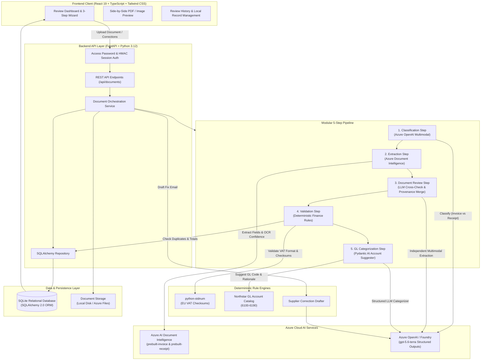
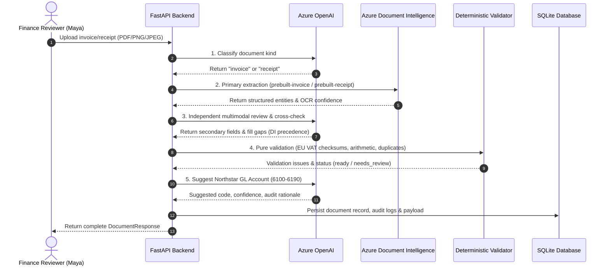

# Invoice Review — Hybrid AI Financial Document Processing & Human-in-the-Loop Platform

[](https://www.python.org/)
[](https://fastapi.tiangolo.com/)
[](https://react.dev/)
[](https://www.typescriptlang.org/)
[](https://tailwindcss.com/)
[](https://azure.microsoft.com/)
[](https://azure.microsoft.com/)
[](https://www.docker.com/)
[](LICENSE)

An enterprise-grade, human-in-the-loop (HITL) intelligent document processing (IDP) platform designed for European accounts payable (AP) auditing. The system automates document classification, OCR extraction, offline EU VAT compliance validation, totals reconciliation, and General Ledger (GL) account categorization across multilingual invoices and expense receipts (English, Dutch, German, French).

---

## Table of Contents

- [Overview & Problem Statement](#overview--problem-statement)
- [Key Features](#key-features)
- [System Architecture](#system-architecture)
- [The 5-Stage Processing Pipeline](#the-5-stage-processing-pipeline)
- [Technology Stack](#technology-stack)
- [Project Structure](#project-structure)
- [Getting Started](#getting-started)
  - [Prerequisites](#prerequisites)
  - [Installation](#installation)
  - [Environment Configuration](#environment-configuration)
  - [Running Locally](#running-locally)
- [Automated Evaluation & Benchmarks](#automated-evaluation--benchmarks)
- [Production Deployment (Docker & Azure)](#production-deployment-docker--azure)
- [API Reference](#api-reference)
- [License](#license)

---

## Overview & Problem Statement

Accounts payable teams handle high volumes of unstructured, multilingual invoices and receipts across digital PDFs, mobile phone photos, and degraded scans. Manual review is slow, prone to arithmetic errors, vulnerable to VAT non-compliance penalties, and susceptible to duplicate billing.

Conventional solutions face a critical trade-off:
- **Pure OCR** struggles with varied layouts, low-quality scans, handwritten entries, and semantic chart-of-accounts mapping.
- **Pure LLM extraction** is vulnerable to arithmetic hallucinations, unreliable checksum calculations, and unpredictable formatting in financial audits.

### The Solution: Hybrid Architecture

This platform implements a **hybrid AI + deterministic validation architecture**:
1. **High-Precision OCR:** Azure AI Document Intelligence provides raw structural extraction (`prebuilt-invoice` and `prebuilt-receipt`).
2. **Independent Multimodal LLM Cross-Check:** Azure OpenAI (`gpt-5.6-terra`) processes raw document bytes independently, backfills missing fields, and preserves transparent field-by-field provenance (`document_intelligence`, `llm_fallback`, `human`).
3. **100% Deterministic Financial Policy:** Pure Python rules enforce offline EU VAT format and checksum validation (`python-stdnum`), arithmetic reconciliation (€0.01 tolerance), purchaser verification, and duplicate invoice detection.
4. **Autonomous GL Accounting Classification:** Pydantic AI agents suggest General Ledger codes with audit rationales from Northstar's chart of accounts (`6100`–`6190`).
5. **Human-in-the-Loop Web Interface:** An interactive React 19 dashboard enables side-by-side document preview, field-level editing with instant re-validation, manual GL overrides, and automated supplier correction email generation.

---

## Key Features

- **Multimodal Document Classification:** Automatically distinguishes between invoices (bills requesting payment) and receipts (records of paid expenses) before routing.
- **Strict Field Provenance Tracking:** Every extracted value retains its explicit data source (`document_intelligence`, `llm_fallback`, or `human`), ensuring complete auditability.
- **Offline European VAT Compliance:** Performs syntax, country prefix, and mathematical checksum validation for all 27 EU member states locally without external network dependencies.
- **Strict Arithmetic Reconciliation:** Mathematically verifies that `subtotal + total_tax == invoice_total` within a strict €0.01 tolerance threshold.
- **Duplicate Prevention:** Employs composite normalized indexing (`vendor_name` + `invoice_number`) to flag duplicate submissions across active reviews.
- **Automated Supplier Correction Drafter:** Translates deterministic validation errors (e.g., missing VAT ID, arithmetic mismatch) into polite, professional email drafts ready for copy-pasting.
- **Human-in-the-Loop Dashboard:** Split-screen layout displaying uploaded PDFs/images alongside extracted fields, discrepancy tables, and status transitions (`ready`, `needs_review`, `approved`, `rejected`).
- **Timing-Safe Session Security:** Shared password protection with constant-time HMAC comparison (`hmac.compare_digest`) and secure HTTP-only cookies for production container deployments.

---

## System Architecture

The application is structured around a layered clean architecture, ensuring external cloud providers, database persistence, and presentation layers remain decoupled from core financial policies.



---

## The 5-Stage Processing Pipeline

Each uploaded document flows through a deterministic, sequential pipeline:



1. **Classification Step:** Binary document bytes are sent to Azure OpenAI via the Responses API (`strict: True`). Returns typed `DocumentClassification` (`invoice` or `receipt`) with confidence score and reasoning.
2. **Extraction Step:** Routes file bytes to Document Intelligence specialized models (`prebuilt-invoice` or `prebuilt-receipt`). Maps vendor, customer, VAT identifiers, invoice dates, line items, and totals into normalized Pydantic domain models.
3. **Document Review Step:** Azure OpenAI independently processes raw file bytes, identifies discrepancies, and backfills missing values without overriding existing OCR values. Maintains explicit source attribution (`field_sources`).
4. **Validation Step:** Executes side-effect-free deterministic checks:
   - Supplier VAT format and mathematical checksum verification via `python-stdnum`.
   - Customer identity verification against Northstar Facilities B.V. (`NL00449544B01`).
   - Arithmetic reconciliation: $|(\text{subtotal} + \text{total\_tax}) - \text{invoice\_total}| \le 0.01\ \text{EUR}$.
   - Normalized duplicate key check (`normalized_vendor_name` + `normalized_invoice_number`).
5. **GL Categorization Step:** An autonomous Pydantic AI agent evaluates normalized line items, vendor name, and amounts against the fixed 10-account Northstar catalog (`6100`–`6190`), attaching suggested account code, confidence score, and rationale.

---

## Technology Stack

| Layer | Technology | Version | Purpose |
| :--- | :--- | :--- | :--- |
| **Backend** | Python | 3.12+ | Core runtime |
| **Framework** | FastAPI | 0.139.0 | High-performance asynchronous REST API |
| **Validation** | Pydantic v2 & Pydantic Settings | 2.13.4 | Schema validation, type contracts, settings management |
| **Agent AI** | Pydantic AI | 2.11.0 | Type-safe structured LLM agents |
| **AI OCR** | Azure AI Document Intelligence | 1.0.2 | Layout analysis and document extraction models |
| **LLM Provider** | Azure OpenAI Service / Azure AI Foundry | `gpt-5.6-terra` | Structured multimodal classification, review & GL categorization |
| **Compliance** | `python-stdnum` | 2.2 | Offline European VAT format and checksum verification |
| **ORM / DB** | SQLAlchemy 2.0 & SQLite | 2.0.51 | Relational persistence, JSON audit trail storage, composite indexing |
| **Frontend** | React 19 | 19.2.7 | Declarative user interface |
| **Language** | TypeScript (Strict Mode) | 6.0.3 | Strict end-to-end type safety |
| **Bundler** | Vite | 8.1.4 | Fast client build tooling |
| **Styling** | Tailwind CSS 4 | 4.3.2 | Utility-first responsive design system |
| **Container** | Docker | Multi-Stage | Unified production image (Node 22 build + Python 3.12 runtime) |
| **Cloud Hosting** | Azure Container Apps & Azure Files | Serverless | Container orchestration with persistent volume storage |
| **Package Mgr** | `uv` (Python) / `pnpm` (Node) | Latest locked | Deterministic, frozen lockfile dependency resolution |

---

## Project Structure

```text
e2e-invoice-review/
├── Dockerfile                         # Unified multi-stage container build
├── .dockerignore
├── backend/
│   ├── app/
│   │   ├── main.py                    # FastAPI application factory & static SPA mount
│   │   ├── config.py                  # Environment settings & application configuration
│   │   ├── database.py                # SQLAlchemy engine & session factory
│   │   ├── accounting/                # GL catalog & accounts endpoints
│   │   │   ├── catalog.py             # Northstar chart of accounts (6100-6190)
│   │   │   ├── routes.py
│   │   │   └── schemas.py
│   │   ├── auth/                      # Session management & password authentication
│   │   │   ├── routes.py
│   │   │   ├── schemas.py
│   │   │   └── session.py             # HMAC constant-time cookie validation
│   │   ├── correction_email/          # Supplier correction request generation
│   │   │   ├── eligibility.py         # Filtering supplier-fixable issues
│   │   │   └── schemas.py
│   │   ├── document_review/           # LLM cross-check & provenance merge
│   │   │   ├── reconciliation.py      # Field gap filling and discrepancy resolution
│   │   │   └── schemas.py
│   │   ├── documents/                 # Document persistence, validation & API routes
│   │   │   ├── models.py              # SQLite ORM models with composite index
│   │   │   ├── projection.py          # Unified ReviewData flat projection
│   │   │   ├── repository.py          # Database operations
│   │   │   ├── routes.py              # Upload, fetch, review, decide, email routes
│   │   │   ├── schemas.py             # DocumentResponse & ReviewData schemas
│   │   │   ├── service.py             # Pipeline orchestration service
│   │   │   └── validation.py          # Pure deterministic EU VAT & arithmetic rules
│   │   ├── pipeline/                  # Composable 5-step pipeline engine
│   │   │   ├── base.py                # Pipeline, PipelineStep Protocol, PipelineContext
│   │   │   ├── classification.py      # Multimodal invoice vs receipt classifier
│   │   │   ├── extraction.py          # Document Intelligence adapter
│   │   │   ├── document_review.py     # Multimodal secondary cross-check step
│   │   │   ├── validation.py          # Validation pipeline step
│   │   │   └── gl_categorization.py   # GL account suggestion agent
│   │   ├── providers/                 # Azure SDK boundary adapters
│   │   │   ├── azure_openai.py
│   │   │   ├── azure_openai_correction_email.py
│   │   │   └── azure_openai_document_review.py
│   │   └── schemas/                   # Invoice & receipt domain schemas & mappings
│   ├── pyproject.toml                 # Backend dependencies pinned with uv
│   ├── uv.lock                        # Reproducible locked Python dependencies
│   └── scripts/                       # Benchmark and verification harnesses
│       ├── check_azure_openai.py
│       ├── check_document_intelligence.py
│       ├── evaluate_corpus.py         # 13-document evaluation benchmark
│       └── evaluate_hybrid.py
├── frontend/
│   ├── src/
│   │   ├── App.tsx                    # Main review workflow machine
│   │   ├── components/                # Modular React components
│   │   │   ├── WelcomePortal.tsx      # Step 1: Welcome portal & quick actions
│   │   │   ├── UploadStep.tsx         # Step 2: Dropzone & local preview
│   │   │   ├── ProcessingStep.tsx     # Animated progress view
│   │   │   ├── DocumentReview.tsx     # Step 3: Interactive review & decision
│   │   │   ├── DocumentPreview.tsx    # Split-screen PDF/image renderer
│   │   │   ├── DocumentReviewSection.tsx
│   │   │   ├── DocumentInbox.tsx      # Saved review history & status table
│   │   │   ├── CorrectionEmailDialog.tsx
│   │   │   ├── LoginPage.tsx          # Password gate for production
│   │   │   └── ui/                    # Base UI elements (Button, Card, Badge, Dialog)
│   │   ├── lib/                       # API clients, helpers & type definitions
│   │   │   ├── api.ts                 # Fetch client with auth error handling
│   │   │   ├── env.ts                 # VITE_API_BASE_URL resolution
│   │   │   └── types.ts               # TypeScript strict contracts
│   ├── package.json
│   ├── pnpm-lock.yaml
│   └── vite.config.ts
├── docs/                              # Technical specifications & guides
│   ├── api-and-pipeline.md
│   ├── architecture.md
│   ├── azure-deploy.md                # Azure Container Apps deployment guide
│   ├── build-along.md                 # Guided development roadmap
│   ├── client-brief.md                # Northstar business requirements
│   └── pricing.md                     # FinOps token and OCR cost models
├── samples/                           # Multilingual evaluation dataset
│   ├── manifest.json                  # Expected extraction & policy issue codes
│   └── generated/                     # 13 sample invoices & receipts (EN, NL, DE, FR)
└── scripts/
    └── dev.sh                         # Unified local development startup script
```

---

## Getting Started

### Prerequisites

- **Python 3.12+**
- **uv** (high-speed Python package manager): `pip install uv` or `curl -LsSf https://astral.sh/uv/install.sh | sh`
- **Node.js 22+**
- **pnpm 11+**: `corepack enable && corepack prepare pnpm@11.3.0 --activate`
- An active **Azure Subscription** with:
  - Azure AI Document Intelligence resource
  - Azure OpenAI resource with a deployed model (e.g. `gpt-5.6-terra` or `gpt-4o`)

### Installation

1. **Clone the repository:**
   ```bash
   git clone https://github.com/ME0W004/e2e-invoice-review.git
   cd e2e-invoice-review
   ```

2. **Install backend dependencies:**
   ```bash
   cd backend
   uv sync --locked
   cd ..
   ```

3. **Install frontend dependencies:**
   ```bash
   cd frontend
   pnpm install --frozen-lockfile
   cd ..
   ```

### Environment Configuration

1. **Configure Backend (`backend/.env`):**
   ```bash
   cp backend/.env.example backend/.env
   ```
   Fill in your Azure resource credentials:
   ```env
   AZURE_DOCUMENT_INTELLIGENCE_ENDPOINT=https://your-resource.cognitiveservices.azure.com/
   AZURE_DOCUMENT_INTELLIGENCE_KEY=your-document-intelligence-api-key

   AZURE_OPENAI_ENDPOINT=https://your-resource.openai.azure.com/openai/v1/
   AZURE_OPENAI_DEPLOYMENT=gpt-5.6-terra
   AZURE_OPENAI_API_KEY=your-azure-openai-api-key

   # Optional shared password for production deployment (leave unset for local dev)
   # APP_ACCESS_PASSWORD=your-secure-password
   # APP_SESSION_SECRET=long-random-secret-key-32-chars
   # ALLOWED_ORIGIN=http://localhost:5173
   ```

2. **Configure Frontend (`frontend/.env`):**
   ```bash
   cp frontend/.env.example frontend/.env
   ```
   For local development:
   ```env
   VITE_API_BASE_URL=http://localhost:8000
   ```

### Running Locally

You can launch both services using the provided orchestration script or independently in two terminals:

#### Option A: Unified Bash Script
```bash
chmod +x scripts/dev.sh
./scripts/dev.sh
```

#### Option B: Separate Terminals

- **Terminal 1 (Backend API):**
  ```bash
  cd backend
  uv run --locked uvicorn app.main:create_app --factory --reload --port 8000
  ```
  The API will be accessible at `http://localhost:8000`. Swagger documentation is available at `http://localhost:8000/docs`.

- **Terminal 2 (Frontend Client):**
  ```bash
  cd frontend
  pnpm dev
  ```
  The React application will be available at `http://localhost:5173`.

---

## Automated Evaluation & Benchmarks

The repository includes a 13-document synthetic golden corpus in [`samples/generated/`](samples/generated/) spanning varied formats, multilingual layouts (English, Dutch, German, French), degraded thermal receipts, arithmetic mismatches, missing VAT IDs, and duplicate keys.

To run the automated benchmark harness:

```bash
cd backend

# Benchmark primary Document Intelligence against manifest
uv run --locked python scripts/evaluate_corpus.py

# Benchmark hybrid Document Intelligence + Azure OpenAI cross-check
uv run --locked python scripts/evaluate_hybrid.py
```

The script evaluates:
- Field-level exact matching across core financial entities.
- Agreement with ground-truth Northstar business policy codes.
- Hybrid fallback utilization rate.

---

## Production Deployment (Docker & Azure)

### Multi-Stage Docker Container

The unified [`Dockerfile`](Dockerfile) compiles the React SPA with `VITE_API_BASE_URL=/`, builds the Python 3.12 runtime, and serves both static assets and API routes from a single origin on port `8000`.

To build and run locally:

```bash
docker build -t invoice-review:latest .

docker run -p 8000:8000 \
  -e AZURE_DOCUMENT_INTELLIGENCE_ENDPOINT="https://..." \
  -e AZURE_DOCUMENT_INTELLIGENCE_KEY="..." \
  -e AZURE_OPENAI_ENDPOINT="https://..." \
  -e AZURE_OPENAI_DEPLOYMENT="gpt-5.6-terra" \
  -e AZURE_OPENAI_API_KEY="..." \
  -e APP_ACCESS_PASSWORD="demo-password" \
  -e APP_SESSION_SECRET="random-session-secret" \
  -v invoice_data:/app/data \
  invoice-review:latest
```

### Azure Container Apps Deployment

Follow the comprehensive guide in [`docs/azure-deploy.md`](docs/azure-deploy.md):

1. **Build image in Azure Container Registry (ACR):**
   ```bash
   az acr build --registry <ACR_NAME> --image invoice-review:latest .
   ```
2. **Mount Persistent Storage:** Provision an **Azure Files Share** and bind it to `/app/data` to ensure the SQLite database and uploaded files persist across container restarts.
3. **Configure Scaling:** Set `minReplicas = 1` and `maxReplicas = 1` (SQLite on mounted network shares requires single-replica write serialization).
4. **Pass Secrets:** Securely inject Azure OpenAI and Document Intelligence credentials as Container App secrets.

---

## API Reference

| Method | Endpoint | Description | Auth Required |
| :--- | :--- | :--- | :---: |
| `GET` | `/health` | Liveness health check | No |
| `GET` | `/api/accounting/gl-accounts` | Retrieve Northstar chart of accounts catalog | Yes (when password set) |
| `POST` | `/api/documents` | Upload PDF/PNG/JPEG and execute 5-step pipeline | Yes (when password set) |
| `GET` | `/api/documents` | List all historical document reviews | Yes (when password set) |
| `GET` | `/api/documents/{id}` | Fetch full review details, discrepancies, and issues | Yes (when password set) |
| `GET` | `/api/documents/{id}/file` | Stream original uploaded file bytes | Yes (when password set) |
| `PUT` | `/api/documents/{id}` | Submit field corrections and re-run policy | Yes (when password set) |
| `PUT` | `/api/documents/{id}/accounting` | Override or confirm selected GL account code | Yes (when password set) |
| `POST` | `/api/documents/{id}/decision` | Set terminal review decision (`approved` / `rejected`) | Yes (when password set) |
| `POST` | `/api/documents/{id}/correction-email` | Generate AI-drafted supplier correction request | Yes (when password set) |
| `DELETE` | `/api/documents/{id}` | Permanently delete review record and physical file | Yes (when password set) |
| `POST` | `/api/auth/login` | Authenticate with shared password | No |
| `GET` | `/api/auth/session` | Inspect current authentication state | No |
| `POST` | `/api/auth/logout` | Clear session cookie | No |

---

## License

This project is licensed under the MIT License — see the [LICENSE](LICENSE) file for details.
